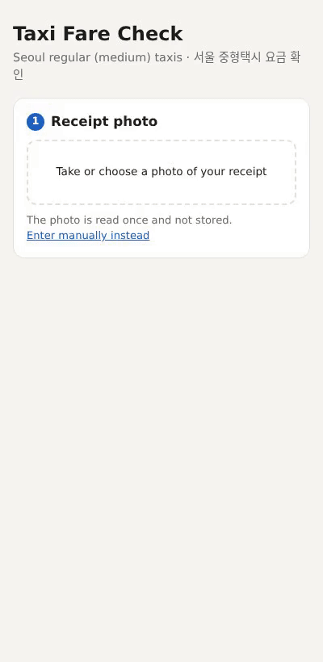

# 바가지 판독기 (farecheck)

외국인 관광객이 택시 영수증과 승하차 정보를 올리면, **결정론적 요금 엔진**이 서울 중형택시 정상 요금 상한을 계산해
"정상 / 확인 필요 / 명백한 초과"로 판정하고, 담당 공무원이 검산할 수 있는 **한국어 신고서**를 만든다.

명세는 [`AGENTS.md`](AGENTS.md) → [`ARCHITECTURE.md`](ARCHITECTURE.md) → [`docs/`](docs/) 순서로 읽는다. 코드는 이 문서를 따른다.



시연 영상: [`demo/farecheck_demo.mp4`](demo/farecheck_demo.mp4) (E8: 명동→김포공항 48만원, 23초)
> 영상은 **데모 모드**로 찍었다. 장소·경로·영수증 인식은 녹화된 fixture 응답이고(화면 상단 DEMO 배지),
> 판정과 신고서는 실제 `fare_engine`·`report` 코드가 계산한 결과다.

## 실행

```bash
uv venv --python 3.11 .venv
uv pip install --python .venv/bin/python -r requirements.txt

cp .env.example .env   # 키 입력 (KAKAO_REST_API_KEY, LLM_API_KEY …)
set -a; . ./.env; set +a
.venv/bin/uvicorn app.main:app --reload          # http://127.0.0.1:8000

# 키 없이 화면 흐름만 보기
FARECHECK_DEMO=1 .venv/bin/uvicorn app.main:app
```

키가 없으면 앱은 뜨고, 해당 기능 호출 시 `LLM_UNAVAILABLE` / `KAKAO_KEY_MISSING` 에러를 낸다.

## 테스트·평가

```bash
.venv/bin/python -m pytest -q                         # 45 tests (fare-rules.md 예시 E1~E8 포함)
.venv/bin/python eval/make_cases.py                   # 평가셋 30건 + 합성 영수증 이미지
.venv/bin/python eval/run_eval.py --cases eval/cases --out eval/report.md
```

현재 [`eval/report.md`](eval/report.md): 엔진 단독 오고발률 0%, 등급 정확도 100%, 명백한 초과 재현율 100%.
단, **경로 fixture 30건 모두 가정값**이고 전체 파이프라인(LLM 추출)은 키가 없어 미실행이다
(`open-questions.md` Q9). 서류용 숫자를 내기 전에 `--refresh-routes`와 `LLM_API_KEY`로 다시 돌려야 한다.

## 시연 영상 다시 만들기

```bash
.venv/bin/python demo/make_demo.py
FARECHECK_DEMO=1 .venv/bin/uvicorn app.main:app --port 8765 &
.venv/bin/python demo/record_demo.py --url http://127.0.0.1:8765   # Chrome + ffmpeg 필요
```

## 구조

| 경로 | 내용 |
|---|---|
| `app/fare_engine/` | 상한 계산·등급 판정. 순수 함수, 외부 호출 없음 |
| `app/extractor/` | 영수증 이미지 → `ReceiptFields` (비전 LLM) + 후처리 |
| `app/geo/` | 카카오 로컬·카카오모빌리티, 공항 판별, 경로 캐시 |
| `app/report/` | 한국어 신고서(Jinja2 템플릿), 사용자 언어 설명(LLM, 실패·금지어 시 고정 템플릿) |
| `app/store/` | SQLite `cases` (이미지·차량번호 저장 안 함) |
| `app/llm.py` | `VisionLLM` 인터페이스, Anthropic 구현, 테스트용 `FakeLLM` |
| `app/demo.py` | 시연 모드 fixture |
| `config/` | `fare_rules.yaml`(요금·임계값), `app.yaml`(공항 좌표, 신고 경로 링크) |
